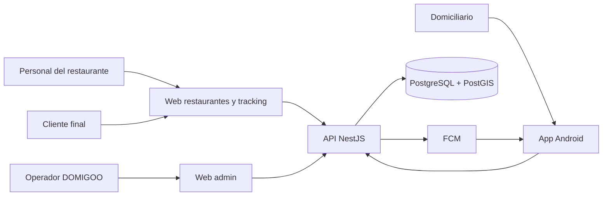
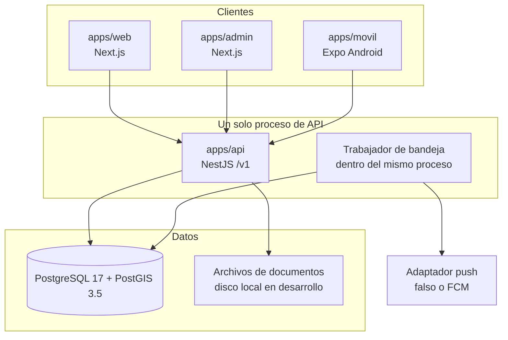
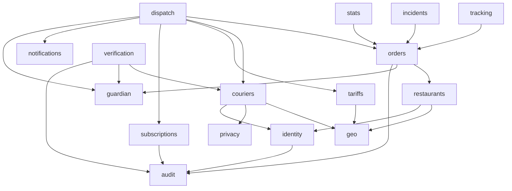
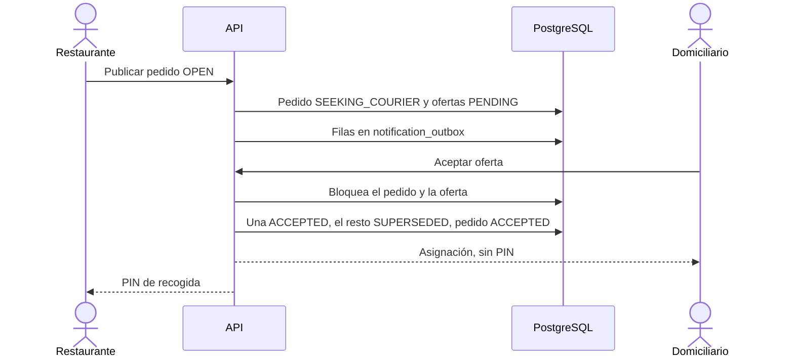
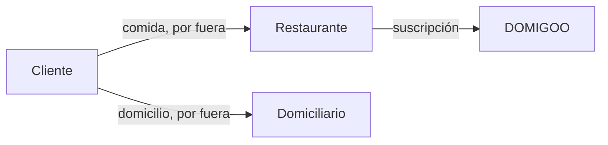

# Arquitectura de DOMIGOO

DOMIGOO es el nombre provisional del producto. El valor que ve la interfaz sale de configuración (`APP_NAME`). Esta documentación no afirma que la marca ni ningún dominio estén disponibles.

Mercado de la primera versión: Tocancipá, Cundinamarca, Colombia. La geografía de servicio es un dato (zona y radio), no una constante repartida por el código, para poder ampliar el polígono sin reescribir el despacho.

## 1. Producto en una frase

DOMIGOO conecta a un restaurante con un domiciliario independiente. El restaurante paga una suscripción a DOMIGOO. El domiciliario no paga por recibir ofertas. El cliente del restaurante paga la comida al restaurante y el domicilio al domiciliario. DOMIGOO no custodia ninguno de esos dos dineros.

Cuatro superficies:

| Superficie | Quién la usa | Cliente técnico |
| --- | --- | --- |
| DOMIGOO Restaurantes | Dueños y personal del restaurante | `apps/web` (Next.js) |
| DOMIGOO Domiciliarios | Domiciliarios en motocicleta | `apps/movil` (Expo, Android) |
| DOMIGOO Admin | Operación, verificación y seguridad | `apps/admin` (Next.js, origen aparte) |
| DOMIGOO Tracking | Cliente final, sin cuenta y sin instalar nada | Ruta pública de `apps/web` |

## 2. Ajustes a la propuesta técnica

Se conserva el encargo: Next.js y TypeScript en la web, React Native con Expo para Android, NestJS, PostgreSQL con PostGIS, Prisma, Redis solo cuando haga falta, FCM detrás de la API, OpenAPI, monolito modular y monorepo con pnpm.

| Ajuste | Motivo |
| --- | --- |
| Prisma ORM **7.10.x estable**, no la 8.0 en release candidate | La 8.0.0-rc cambia el formato del contrato (`contract.prisma`, paquetes `@prisma/orm-*`) y sigue moviéndose. El borrador tiene que validarse hoy. La extensión PostGIS de Prisma 8 se reevalúa cuando deje de ser candidata. Ver [ADR-003](decisiones/ADR-003-prisma-7-y-postgis.md). |
| `geography` con `Unsupported` e índice GiST | Prisma 7 no tiene tipo geography de primera clase. `geography(Point,4326)` devuelve metros en `ST_DWithin`. El SQL generado se aplicó en PostGIS 3.5. |
| Sin Redis en V1 | La aceptación exclusiva de una oferta se cierra con bloqueo de fila en PostgreSQL. Una sola réplica de la API cubre el mercado inicial. Redis entra al publicar más de una réplica o al necesitar presencia efímera. |
| Verificación automática = reglas sobre datos estructurados. La aprobación final es humana. Sin proveedores de IA ni OCR | El encargo de esta fase prohíbe otros modelos. Una decisión sobre documentos de identidad no puede depender de un modelo opaco. |
| Admin en una aplicación Next distinta | La consola ve cédulas, SOAT y sanciones. Separar el origen reduce el alcance de un XSS en el portal del restaurante. |
| Tracking dentro de `apps/web`, sin sesión | Es una página al portador del enlace. No justifica un tercer despliegue. |
| Sin pasarela, sin billetera y sin números de cuenta | El medio de pago se registra. No se procesa. Guardar el número de Nequi o Daviplata no aporta y sí amplía el dato personal. |
| Sin geocodificador de pago | El restaurante envía latitud y longitud. No hay clave de un mapa de terceros en el servidor. |
| Bandeja de salida en PostgreSQL | El push no se pierde si el proceso se reinicia, y no añade un broker. |
| Identificadores de código en inglés, textos de producto en español | El esquema y los módulos ya usan ese criterio. La copia de interfaz se escribe en español. |

## 3. Principios

1. NestJS es la única fuente de reglas de negocio. Next.js presenta y reenvía; no decide si un pedido puede publicarse.
2. Un módulo no importa el dominio de otro para evitar ciclos. Se hablan por puertos (interfaces) definidos en el núcleo.
3. Toda transición de pedido, toda decisión de verificación y toda suspensión escriben un hecho. La auditoría no se actualiza ni se borra.
4. El valor de la comida y el valor del domicilio son columnas distintas en toda la vida del pedido.
5. El domiciliario solo ve el domicilio, la distancia y la zona antes de aceptar. El nombre y el teléfono del cliente aparecen después de la aceptación.
6. El PIN de recogida lo ve el restaurante. El PIN de entrega lo ve quien tiene el enlace de tracking. El domiciliario solo los digita.
7. La invitación no salta la verificación.
8. V1 no crea microservicios. Extraer uno exige un ADR nuevo.

## 4. Contexto



El cliente final no tiene cuenta. Llega por un enlace que le comparte el restaurante. Firebase Cloud Messaging solo transporta un aviso corto al teléfono del domiciliario. El cuerpo del aviso no lleva dirección, teléfono, documento ni PIN.

No aparece en el diagrama, a propósito, una pasarela de pagos ni una billetera.

## 5. Contenedores



En desarrollo y en CI la API y el trabajador viven en un proceso. El trabajador consulta `notification_outbox`. No hay cron del sistema operativo ni cola externa.

OpenAPI se publica en `/docs` y el contrato JSON en `/openapi.json`. Los clientes generan tipos desde ese contrato; no se mantiene un paquete de enums escrito a mano en paralelo.

## 6. Monorepo previsto

Todavía no existe el código. M01 lo crea con pnpm workspaces.

```text
apps/api          NestJS. Reglas, persistencia, OpenAPI.
apps/web          Restaurantes y la página pública de tracking.
apps/admin        Verificación, tarifas, suscripciones, incidentes, estadísticas.
apps/movil        Expo, solo Android en V1.
packages/config   tsconfig y configuración de lint compartida.
docs              Este diseño. El esquema ejecutable se muda a apps/api en M04.
```

`packages/api-client` aparece cuando el primer cliente genere tipos desde OpenAPI (M29). Antes de eso no hay un contrato duplicado.

## 7. Módulos del backend

El detalle, los puertos y las máquinas de estado están en [modulos.md](modulos.md). La regla de dirección es esta:



`guardian` no importa módulos de negocio: recibe hechos ya cargados y devuelve permitir o rechazar. `audit` expone un puerto de escritura; no lee agregados de pedidos para decidir.

`geo` y `storage` son infraestructura. `geo` es el único lugar con SQL de PostGIS.

## 8. Despacho

Hay dos modos. El modo es un atributo del pedido (`DIRECT` u `OPEN`), no un estado distinto.



La transacción de aceptación:

1. `SELECT … FOR UPDATE` del pedido si sigue en `SEEKING_COURIER`.
2. `SELECT … FOR UPDATE` de la oferta si sigue `PENDING` y no venció.
3. La oferta pasa a `ACCEPTED`. Las otras ofertas `PENDING` del pedido pasan a `SUPERSEDED`.
4. El pedido pasa a `ACCEPTED`, guarda el domiciliario y genera el PIN de recogida.
5. La disponibilidad pasa a `ON_SERVICE`.

Un índice único parcial —una oferta `ACCEPTED` por pedido— es la red de seguridad si dos transacciones se cruzan. Está especificado en [modelo-datos.md](modelo-datos.md). No hace falta un candado en Redis.

En modo directo el restaurante elige un domiciliario elegible dentro del radio. Si ese rechaza o vence, el pedido sigue en `SEEKING_COURIER` y el restaurante puede ofrecer a otro o cambiar a modo abierto.

Antes de aceptar, la oferta muestra: tarifa del domicilio, distancia, zona, barrio de la sucursal y tiempo restante. No muestra el monto de la comida, ni el nombre, ni el teléfono del cliente.

## 9. Dinero



| Concepto | Columna o registro | Quién lo cobra | Qué hace la API |
| --- | --- | --- | --- |
| Comida | `orders.foodAmountCop` | El restaurante | Lo guarda y lo muestra al restaurante y al admin. El domiciliario no lo ve. |
| Domicilio | `orders.deliveryFeeCop` y la cotización | El domiciliario, en el punto de entrega | Calcula la tarifa, la congela en `tariff_quotes` y la muestra a las dos partes del servicio. |
| Suscripción | `restaurant_subscriptions.priceCop` | DOMIGOO | Registra una declaración manual. Un admin la reconoce. No hay cobro automático. |

Medios que se pueden **registrar**: efectivo, Nequi, Daviplata y transferencia. El mismo enumerado sirve para el domicilio declarado en el pedido y para la declaración de suscripción. En los dos casos es una etiqueta. No se guarda número de cuenta, número de celular de la billetera ni identificador de una pasarela.

La cotización copia la versión de tarifa, la zona, los metros y el desglose. Si al día siguiente se publica otra tarifa, el pedido en curso no cambia.

## 10. Tracking

El enlace lleva 32 bytes aleatorios, codificados en base64url. En la base se guarda el SHA-256 del token y una copia cifrada para que el personal del restaurante pueda volver a copiarlo. La búsqueda pública compara el hash en tiempo constante.

La página muestra estado, primer nombre del domiciliario, placa y la última posición mientras el servicio está activo. No muestra teléfono del domiciliario, documento, monto de la comida ni el PIN de recogida. El PIN de entrega aparece cuando el estado es `PICKED_UP` o `AT_DROPOFF`.

El enlace vence a las horas configuradas en la política operativa después de un estado terminal, y se puede revocar. La respuesta lleva `noindex` y `Referrer-Policy: no-referrer`.

## 11. Identidad y Guardian

DOMIGOO Identity cubre cuenta, sesión, membresía y verificación. DOMIGOO Guardian cubre las reglas que esas operaciones no pueden saltarse: suscripción vigente para publicar, domiciliario aprobado y con documentos al día para recibir ofertas, consentimiento vigente para guardar GPS, tope de intentos de PIN, motivo obligatorio en una decisión humana.

Sesiones:

- Web y admin: cookie `HttpOnly`, `Secure`, `SameSite`.
- App: token de sesión en el dispositivo, rotación al refrescar, revocación en `sessions.revokedAt`.
- Contraseñas con Argon2id.

La verificación automática revisa, como mínimo: conjunto de documentos obligatorio, tipo de vehículo motocicleta, placa sin otro vehículo activo, SOAT y tecnomecánica con fecha futura, y tamaño y tipo de archivo. Si una regla dura falla, el caso vuelve a `NEEDS_CHANGES` con el código de la regla. Si todas pasan, el caso queda en `PENDING_HUMAN`. Ningún camino automático escribe `APPROVED`.

El revisor humano deja `VerificationDecision` (resultado, código de motivo y comentario) y una fila de auditoría. En la misma transacción se actualiza `couriers.status`.

## 12. Ubicación

- SRID 4326. Columna `geography`, no `geometry`, para que el radio sea en metros.
- La sucursal, la disponibilidad, el ping, la recogida, la entrega y la zona de tarifa tienen índice GiST.
- Un domiciliario solo envía posición si hay un `ConsentRecord` de propósito `GEOLOCATION` sin revocar, y la disponibilidad apunta a ese consentimiento.
- La posición que cuenta para ofrecer servicios es la de `courier_availabilities`, y solo si `recordedAt` no supera `locationFreshnessSeconds` de la política publicada.
- `location_pings` es histórico de corta vida (30 días) para un incidente o un tracking reciente. La búsqueda de candidatos no recorre esa tabla.
- Al pasar a `OFFLINE` se deja de aceptar pings de disponibilidad. Durante `ON_SERVICE` el ping sigue, asociado al pedido, porque el tracking lo necesita y el consentimiento sigue vigente.

No hay mapa de terceros en el servidor. Una misión posterior puede mostrar un mapa en el navegador con teselas públicas; eso no cambia la API.

## 13. Notificaciones

El puerto `PushSender` tiene dos adaptadores:

| Adaptador | Cuándo |
| --- | --- |
| `RecordingPushSender` | Pruebas y desarrollo. Guarda plantilla, usuario y payload ya minimizado. |
| `FcmPushSender` | Solo si la configuración trae el proyecto y la credencial. Fuera de CI. |

Plantillas previstas: oferta nueva, oferta retirada, pedido cancelado, decisión de verificación. El payload lleva identificadores internos y un texto corto en español. Quien abre la app pide el detalle a la API, con autorización.

Firebase recibe el token del dispositivo y ese payload mínimo. Es una transmisión fuera de Colombia y el aviso de privacidad tiene que decirlo. Ver [ADR-009](decisiones/ADR-009-datos-personales.md).

## 14. Ambientes

| Ambiente | Base | Push | Documentos | Existe hoy |
| --- | --- | --- | --- | --- |
| VM del agente y portátil | Compose `postgis/postgis:17-3.5` | Adaptador que registra | Disco local privado | La VM puede levantarlo; ver [entorno.md](entorno.md) |
| GitHub Actions | El mismo imagen como servicio | Adaptador que registra | Directorio temporal | Se crea en M02 |
| Producción | PostgreSQL con PostGIS, copias y rol de aplicación | FCM con credencial fuera del repo | Almacén privado con URL firmada de corta vida | No se diseña el alta ni se despliega en esta fase |

La API futura se publica bajo el mismo sitio que la web (`/api` hacia Nest) para que la cookie sea de primer sitio. Admin usa otro origen y su propia cookie. Eso es una decisión de despliegue posterior; M03 solo expone la API en local.

## 15. Fuera de alcance de V1

- iOS, bicicletas u otros vehículos, y una app nativa para el restaurante.
- Cuenta de cliente final, chat, propinas dentro de la plataforma y calificación.
- Pasarela, split de pagos, reembolsos procesados por DOMIGOO y facturación electrónica.
- Microservicios, Kubernetes y Redis.
- OCR, biometría automatizada y cualquier proveedor de modelos.
- Publicar en Play Store, comprar dominios o abrir producción.

## 16. Lectura siguiente

- Datos: [modelo-datos.md](modelo-datos.md) y [apps/api/prisma/schema.prisma](../apps/api/prisma/schema.prisma)
- Módulos y estados: [modulos.md](modulos.md)
- Misiones: [plan-misiones.md](plan-misiones.md)
- Pruebas y seguridad: [pruebas-y-seguridad.md](pruebas-y-seguridad.md)
- Decisiones, riesgos y ejecución: [decisiones/README.md](decisiones/README.md)
