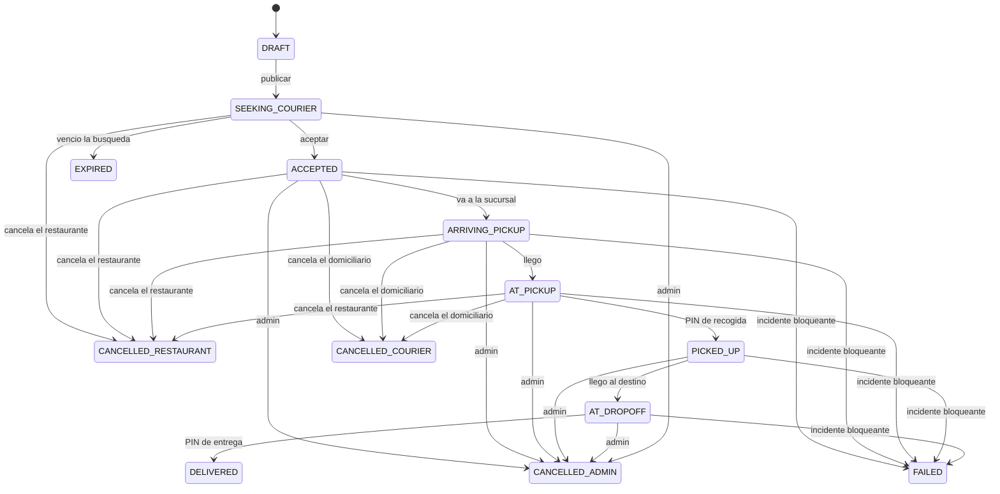
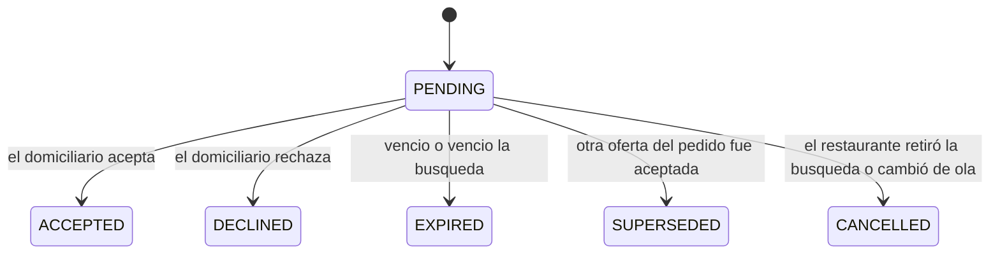
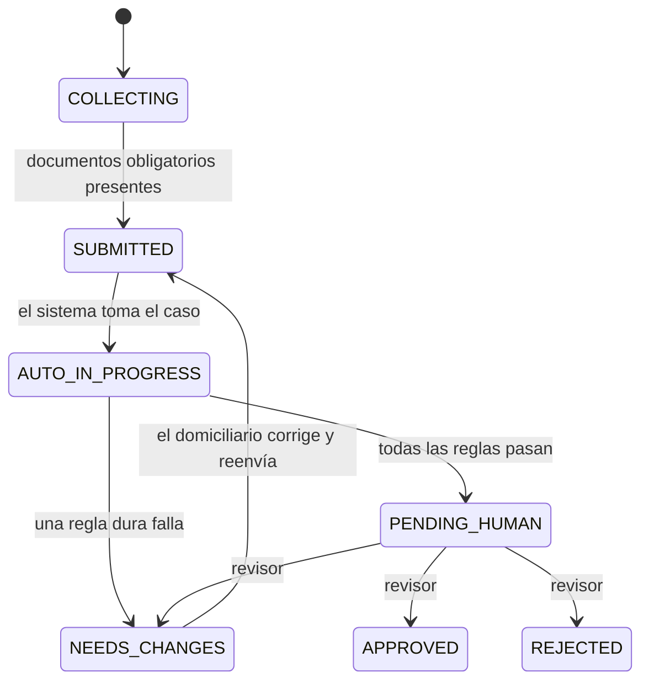
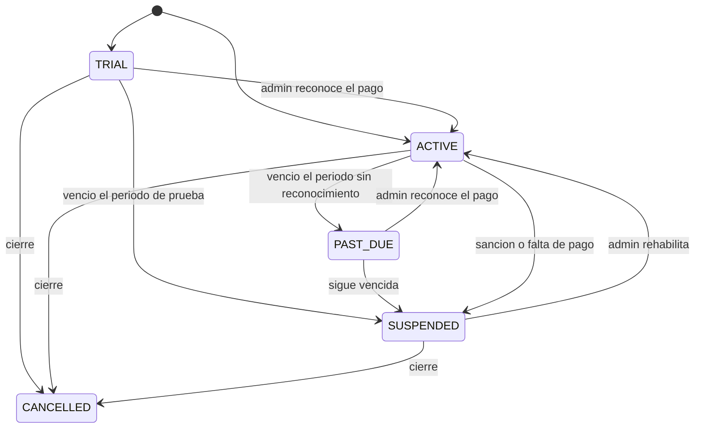

# Módulos del backend

La API es un monolito NestJS. Cada módulo de esta lista es un módulo Nest con su carpeta en `apps/api/src/modules`. Las reglas puras (transiciones, cotización, elegibilidad, PIN) viven en funciones sin Nest ni Prisma, para probarlas sin base.

## 1. Dirección de las dependencias

Un módulo de la columna "usa" puede llamar el puerto. No importa el módulo de dominio de la otra parte.

| Módulo | Responsabilidad | Usa | No hace |
| --- | --- | --- | --- |
| `identity` | Cuenta, sesión, invitación de personal, papel de admin, membresía | `audit` | No verifica documentos ni publica pedidos |
| `privacy` | Versiones legales, consentimiento, solicitudes de habeas data | `identity`, `audit` | No decide elegibilidad |
| `restaurants` | Restaurante, establecimiento, sucursal, horario | `identity`, `geo`, `audit` | No calcula tarifas |
| `couriers` | Alta, vehículo, documentos, disponibilidad, pings | `identity`, `privacy`, `geo`, `storage`, `audit` | No aprueba solo |
| `verification` | Reglas automáticas y decisión humana | `couriers`, `guardian`, `audit` | No llama a un modelo ni a un OCR |
| `tariffs` | Versiones, zonas, reglas y cotización | `geo` | No cobra |
| `subscriptions` | Planes, periodo, declaración, compuerta | `restaurants`, `audit` | No habla con una pasarela |
| `orders` | Borrador, montos, recorrido, PIN, cancelación | `restaurants`, `tariffs`, `guardian`, `audit` | No elige candidatos |
| `dispatch` | Oferta directa, ola abierta, aceptación exclusiva | `orders`, `couriers`, `tariffs`, `subscriptions`, `notifications`, `guardian` | No calcula el precio por su cuenta: usa la cotización |
| `tracking` | Enlace y lectura pública | `orders` | No muestra datos de más |
| `incidents` | Casos e historial | `orders`, `couriers`, `restaurants`, `audit` | No cierra un pedido sin pasar por `orders` |
| `notifications` | Tokens, bandeja, adaptador push | `identity` | No arma textos con PII de más |
| `stats` | Lecturas agregadas para admin | lecturas de pedidos, domiciliarios e incidentes | No escribe negocio |
| `guardian` | Funciones puras de política | ninguna | No carga la base |
| `geo` | SQL de PostGIS | Prisma | No conoce estados de pedido |
| `storage` | Guardar y leer bytes privados | sistema de archivos | No sirve el archivo en una ruta pública |
| `audit` | Insertar en `audit_logs` | Prisma | No actualiza ni borra |

El trabajador de la bandeja vive en `notifications` y arranca con la API. El vencimiento de búsquedas y de documentos es un segundo ciclo interno, en `dispatch` y `verification`, con el mismo reloj. No hay un scheduler externo.

## 2. Puertos

Firmas de diseño. M03 deja el lugar; cada misión implementa el puerto que necesita.

```ts
interface AuditPort {
  record(entry: {
    actorId: string | null;
    actorKind: "RESTAURANT" | "COURIER" | "ADMIN" | "SYSTEM";
    action: string;
    entityType: string;
    entityId: string;
    reason?: string;
    diff?: Record<string, unknown>;
  }): Promise<void>;
}

interface GeoPort {
  withinRadius(origin: GeoPoint, radiusMeters: number, freshnessSeconds: number): Promise<string[]>;
  distanceMeters(a: GeoPoint, b: GeoPoint): Promise<number>;
  zoneContaining(versionId: string, point: GeoPoint): Promise<{ code: string } | null>;
}

interface TariffPort {
  quote(input: {
    pickup: GeoPoint;
    dropoff: GeoPoint;
    at: Date;
  }): Promise<TariffQuoteSnapshot>;
}

interface SubscriptionGate {
  assertCanDispatch(restaurantId: string, at: Date): Promise<void>;
}

interface CourierEligibility {
  assertCanReceiveOffers(courierId: string, at: Date): Promise<void>;
}

interface PushSender {
  send(message: { userId: string; template: string; payload: Record<string, string> }): Promise<void>;
}

interface ObjectStorage {
  put(input: { key: string; body: Buffer; mimeType: string }): Promise<void>;
  get(key: string): Promise<Buffer>;
  delete(key: string): Promise<void>;
}
```

`GeoPoint` es `{ longitude: number; latitude: number }`. El orden al construir el WKT es longitud y luego latitud.

`guardian` exporta funciones puras que estos puertos usan después de cargar los hechos: `canPublish(facts)`, `canReceiveOffer(facts)`, `pinDecision(attempts, max)`, `mustHideCustomerContact(offerStatus)`.

## 3. Superficie HTTP

Prefijo `/v1`. Los cuerpos y los códigos exactos los fija el OpenAPI de cada misión. Esta tabla evita inventar otros recursos.

| Método y ruta | Módulo | Autorización |
| --- | --- | --- |
| `POST /v1/auth/register` | identity | Pública, con consentimiento de cuenta |
| `POST /v1/auth/login` | identity | Pública |
| `POST /v1/auth/logout` | identity | Sesión |
| `GET /v1/auth/me` | identity | Sesión |
| `POST /v1/restaurants` | restaurants | Sesión nueva de dueño |
| `POST /v1/restaurants/:id/members` | restaurants | `OWNER` |
| `POST /v1/restaurants/:id/establishments` | restaurants | `OWNER` o `MANAGER` |
| `POST /v1/establishments/:id/branches` | restaurants | `OWNER` o `MANAGER` |
| `PUT /v1/branches/:id/hours` | restaurants | `OWNER` o `MANAGER` |
| `POST /v1/branches/:id/activate` | restaurants | `OWNER` o `MANAGER`, sucursal con punto |
| `POST /v1/couriers` | couriers | Sesión, consentimiento de documentos |
| `POST /v1/courier-invitations` | couriers | Admin o membresía de restaurante |
| `POST /v1/courier-invitations/:token/accept` | couriers | Sesión del invitado |
| `POST /v1/couriers/me/vehicle` | couriers | El propio domiciliario |
| `POST /v1/couriers/me/documents` | couriers | El propio, multipart |
| `POST /v1/couriers/me/verification-cases` | verification | El propio, documentos completos |
| `GET /v1/admin/verification-cases` | verification | `REVIEWER` o `SUPERADMIN` |
| `POST /v1/admin/verification-cases/:id/decision` | verification | `REVIEWER` o `SUPERADMIN`, motivo obligatorio |
| `POST /v1/couriers/me/availability` | couriers | El propio, con consentimiento GPS si pasa a `AVAILABLE` |
| `POST /v1/couriers/me/location` | couriers | El propio, consentimiento vigente |
| `GET /v1/branches/:id/couriers` | dispatch | Membresía, solo elegibles dentro del radio, sin teléfono del cliente |
| `POST /v1/orders` | orders | Membresía operativa |
| `POST /v1/orders/:id/quote` | orders | Membresía del pedido |
| `POST /v1/orders/:id/publish` | dispatch | Membresía, modo `DIRECT` u `OPEN` |
| `POST /v1/orders/:id/offers` | dispatch | Otra oferta directa mientras sigue `SEEKING_COURIER` |
| `POST /v1/offers/:id/accept` | dispatch | Domiciliario de esa oferta. Header de idempotencia |
| `POST /v1/offers/:id/decline` | dispatch | Domiciliario de esa oferta |
| `POST /v1/orders/:id/arrive-pickup` | orders | Domiciliario asignado |
| `POST /v1/orders/:id/at-pickup` | orders | Domiciliario asignado |
| `POST /v1/orders/:id/pickup-pin` | orders | Domiciliario asignado |
| `POST /v1/orders/:id/at-dropoff` | orders | Domiciliario asignado |
| `POST /v1/orders/:id/delivery-pin` | orders | Domiciliario asignado |
| `POST /v1/orders/:id/cancel` | orders | Según la máquina |
| `GET /v1/tracking/:token` | tracking | Al portador del token. Sin cookie |
| `POST /v1/admin/tariff-versions/:id/publish` | tariffs | `OPERATIONS` o `SUPERADMIN` |
| `POST /v1/admin/operations-policies/:id/publish` | tariffs | `OPERATIONS` o `SUPERADMIN` |
| `POST /v1/admin/subscriptions/:id/acknowledge-payment` | subscriptions | `OPERATIONS` o `SUPERADMIN` |
| `POST /v1/admin/couriers/:id/suspension` | incidents | `OPERATIONS`, `SECURITY` o `SUPERADMIN` |
| `POST /v1/incidents` | incidents | Sesión autenticada |
| `GET /v1/admin/stats` | stats | `OPERATIONS`, `SECURITY` o `SUPERADMIN` |

`GET /health` y `GET /ready` no llevan prefijo de versión. `ready` falla si la base no responde.

## 4. Máquina del pedido



Cada flecha inserta `order_events` y una auditoría. No hay otras flechas. `DELIVERED`, `EXPIRED`, `CANCELLED_RESTAURANT`, `CANCELLED_COURIER`, `CANCELLED_ADMIN` y `FAILED` no tienen salida.

| Transición | Quién | Guardas | Efectos además del estado |
| --- | --- | --- | --- |
| `DRAFT` → `SEEKING_COURIER` | Membresía `OWNER`, `MANAGER` u `OPERATOR` | `canPublish`. Cotización presente e igual a `deliveryFeeCop`. `paymentMethod`, nombre, teléfono, dirección y punto de entrega presentes. Política y tarifa publicadas copiadas al pedido. Si el modo es `DIRECT`, el domiciliario es elegible y está en el radio. | Copiar el punto de la sucursal a `pickupLocation`. Fijar `seekingExpiresAt`. Crear la oferta o la ola. Encolar push sin datos del cliente. |
| `SEEKING_COURIER` → `ACCEPTED` | Domiciliario de la oferta | Pedido bloqueado y aún en búsqueda. Oferta `PENDING` y no vencida. Sigue siendo elegible. | Oferta `ACCEPTED`. Hermanas `PENDING` a `SUPERSEDED`. `assignedCourierId`. Disponibilidad `ON_SERVICE`. Generar PIN de recogida. `acceptedAt`. |
| `SEEKING_COURIER` → `EXPIRED` | Sistema | `now >= seekingExpiresAt` | Ofertas `PENDING` a `EXPIRED` |
| Hacia `CANCELLED_RESTAURANT` | Membresía del pedido | Estado en `SEEKING_COURIER`, `ACCEPTED`, `ARRIVING_PICKUP` o `AT_PICKUP` | Ofertas `PENDING` a `CANCELLED`. Si había asignado, su disponibilidad vuelve a `AVAILABLE`. |
| Hacia `CANCELLED_COURIER` | Domiciliario asignado | Estado en `ACCEPTED`, `ARRIVING_PICKUP` o `AT_PICKUP` | Igual que la fila anterior. Motivo obligatorio. |
| Hacia `CANCELLED_ADMIN` o `FAILED` | `OPERATIONS`, `SECURITY` o `SUPERADMIN`. `FAILED` también puede dispararlo un incidente crítico | Motivo obligatorio. `FAILED` exige un incidente abierto ligado al pedido. | Liberar disponibilidad si el domiciliario no queda en otro servicio. Anular cifrados de PIN. |
| `ACCEPTED` → `ARRIVING_PICKUP` → `AT_PICKUP` | Domiciliario asignado | Es el asignado | Solo el evento |
| `AT_PICKUP` → `PICKED_UP` | Domiciliario asignado | PIN de recogida correcto e intentos por debajo del máximo | `pickedUpAt`. Generar PIN de entrega. Un fallo suma intento y no cambia el estado. Al llegar al máximo el estado no cambia y se abre incidente `PIN_LOCKOUT`. |
| `PICKED_UP` → `AT_DROPOFF` | Domiciliario asignado | Es el asignado | Solo el evento |
| `AT_DROPOFF` → `DELIVERED` | Domiciliario asignado | PIN de entrega correcto, con el mismo tope de intentos | `deliveredAt`. Disponibilidad `AVAILABLE`. Anular cifrados de PIN. Fijar vencimiento del tracking según la política. |

Mientras el pedido sigue en `SEEKING_COURIER` se puede crear otra ola directa o pasar el modo a `OPEN`. Eso no es un cambio de estado. Las ofertas `PENDING` anteriores de esa acción se cancelan.

Después de `PICKED_UP` el restaurante y el domiciliario ya no cancelan. La comida salió del local. El cierre lo hace el admin (`CANCELLED_ADMIN` o `FAILED`).

## 5. Máquina de la oferta



`ACCEPTED` es única por pedido gracias al índice parcial. Aceptar es idempotente: la misma clave de idempotencia y el mismo hash de cuerpo devuelven la misma respuesta; otro cuerpo con la misma clave responde conflicto.

## 6. Máquina de verificación



Reglas duras de V1, en este orden, todas deterministas:

| Código | Falla cuando |
| --- | --- |
| `REQUIRED_DOCUMENTS` | Falta alguno de: cédula, licencia, SOAT, tecnomecánica, foto del vehículo, foto de perfil |
| `FILE_BOUNDS` | El MIME no está en la lista o el tamaño pasa el tope (10 MB por archivo) |
| `VEHICLE_MOTORCYCLE` | No hay vehículo `ACTIVE` de tipo `MOTORCYCLE` |
| `PLATE_UNIQUE` | Otra fila `ACTIVE` tiene la misma placa |
| `SOAT_VALID` | `soatExpiresOn` no es posterior a hoy |
| `TECH_VALID` | `techExpiresOn` no es posterior a hoy |
| `IDENTITY_UNIQUE` | Otro domiciliario ya tiene el mismo tipo y número de documento |

Una falla lleva el caso a `NEEDS_CHANGES` y el domiciliario a `NEEDS_CHANGES`. Cero fallas llevan el caso a `PENDING_HUMAN` y el domiciliario a `PENDING_VERIFICATION`. El revisor es quien escribe `APPROVED` o `REJECTED`.

`REJECTED` cierra el caso. Una suspensión posterior no cambia esa decisión: cambia `couriers.status` a `SUSPENDED` y escribe auditoría e, si aplica, un incidente. Rehabilitar vuelve el estado a `APPROVED` solo si el último caso sigue `APPROVED` y los documentos no vencieron.

Un documento con fecha vencida pasa a `EXPIRED` y el domiciliario a `NEEDS_CHANGES`. Deja de ser elegible aunque el caso viejo diga `APPROVED`.

La invitación, abierta o nominativa, termina en el mismo embudo. `registrationSource` solo recuerda el origen.

## 7. Máquina de la suscripción



Reconocer una declaración no llama a un banco. Cambia el estado de la declaración a `ACKNOWLEDGED` y, si el admin lo confirma en la misma acción, abre o renueva el periodo. El alta inicial puede nacer en `TRIAL` si el plan tiene `trialDays` mayor que cero, o en `ACTIVE` si un admin deja constancia desde el primer día.

`PAST_DUE`, `SUSPENDED` y `CANCELLED` no pasan `canPublish`. `TRIAL` y `ACTIVE` sí, mientras `now < periodEndsAt`.

El restaurante también tiene estado propio. Solo `ACTIVE` publica. `PENDING_REVIEW` es la revisión ligera de la cuenta (NIT y datos de contacto) antes de operar. No usa el caso documental del domiciliario.

## 8. Elegibilidad y ocultamiento

`canReceiveOffer` exige todos estos hechos a la vez:

- `couriers.status = APPROVED`
- vehículo activo motocicleta, SOAT y tecnomecánica vigentes
- los seis tipos documentales en `ACCEPTED` y sin `declaredExpiresOn` vencida
- disponibilidad `AVAILABLE`
- `consentId` de geolocalización no revocado
- `recordedAt` dentro de la frescura
- ningún pedido no terminal ya asignado

`mustHideCustomerContact` es verdadero mientras la oferta está `PENDING` y también en el tracking. Pasa a falso para el domiciliario asignado desde `ACCEPTED` hasta el estado terminal, porque necesita el teléfono para coordinar la entrega. Las respuestas posteriores al cierre vuelven a ocultarlo.

El monto de la comida permanece oculto para el domiciliario en todos los estados.

## 9. PIN y enlace

- Longitud por defecto: 6 dígitos, tomada de la política congelada en el pedido.
- Generación: CSPRNG, rechazando sesgo de módulo.
- Verificación: HMAC-SHA-256 con pepper de entorno y dato asociado `orderId || kind`. Comparación en tiempo constante.
- Presentación: AES-256-GCM con otra clave de entorno. El dato asociado incluye `orderId` y el tipo de PIN, para que un cifrado no se reutilice en el otro campo.
- El recurso del domiciliario nunca devuelve los PIN. El del restaurante devuelve el de recogida solo en `ACCEPTED`, `ARRIVING_PICKUP` y `AT_PICKUP`. El tracking devuelve el de entrega solo en `PICKED_UP` y `AT_DROPOFF`.

El token de tracking es de 32 bytes. Se guarda su SHA-256. La copia cifrada usa la misma clave de aplicación con un dato asociado distinto (`tracking`). El restaurante autenticado puede pedir el enlace otra vez. El público solo puede canjear el token crudo.

## 10. Cotización

1. Tomar la única versión de tarifa `PUBLISHED`.
2. Medir metros entre sucursal y destino.
3. Elegir la zona de mayor `priority` cuyo polígono contiene el destino. Si ninguna contiene, usar la regla con `zoneId` nulo.
4. `fee = baseFeeCop + perKmCop * (metros / 1000)`.
5. Si la hora local de Bogotá (`America/Bogota`) cae en la franja nocturna, multiplicar por `nightMultiplierBps / 10000` con aritmética entera.
6. Aplicar `minimumFeeCop`.
7. Persistir la instantánea. El pedido, al publicarse, copia `deliveryFeeCop` de esa instantánea.

La zona inicial de desarrollo puede ser un polígono amplio alrededor de Tocancipá cargado como semilla. No es el límite municipal oficial mientras el negocio no entregue el polígono. El motor no cambia cuando el polígono se reemplace: cambia la versión publicada.

## 11. Ciclos internos

Cada minuto, en el proceso de la API:

- Búsquedas con `seekingExpiresAt` vencido pasan a `EXPIRED`.
- Ofertas `PENDING` vencidas pasan a `EXPIRED`.
- Suscripciones con `periodEndsAt` vencido pasan de `TRIAL` a `SUSPENDED` o de `ACTIVE` a `PAST_DUE`, y escriben `subscription_events` con actor de sistema.
- Documentos con `declaredExpiresOn` anterior a hoy pasan a `EXPIRED` y el domiciliario elegible deja de serlo.
- La bandeja envía filas `PENDING` con `availableAt <= now()`, con reintentos acotados (5) y error redactado.

Estos ciclos son idempotentes: correrlos dos veces no duplica eventos de un pedido que ya cambió.
