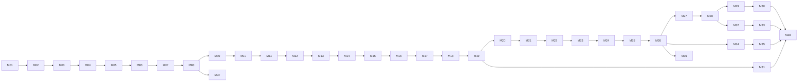

# Plan de misiones

Cada misión es un pull request. No se empieza la siguiente si la anterior no cumple sus criterios. El orden de abajo es el orden de ejecución. Las fases agrupan el relato; no autorizan a saltar una misión.

El esquema de [apps/api/prisma/schema.prisma](../apps/api/prisma/schema.prisma) es el contrato. M04 lo materializa. Las misiones posteriores implementan comportamiento sobre esas tablas y solo alteran el esquema si un ADR lo dice.

No forman parte de ninguna misión: proveedores de IA, pasarelas, alta de dominios, publicación en tiendas, despliegue a producción y datos reales de personas.

## Fase 1. Cimientos

### M01. Monorepo y calidad estática

- **Alcance.** `pnpm-workspace.yaml`, `package.json` raíz, `packages/config` con tsconfig estricto, ESLint y Prettier. `.gitignore` de Node. Workflow de GitHub Actions que instala y ejecuta typecheck y lint. Sin aplicaciones de negocio.
- **Dependencias.** Ninguna.
- **Pruebas.** El workflow en seco: los scripts salen con código 0 en local.
- **Criterios.** `pnpm install`, `pnpm lint` y `pnpm typecheck` salen 0. El workflow existe y no pide secretos. No hay código de pedidos, usuarios ni Docker todavía.

### M02. PostGIS en local y en CI

- **Alcance.** `docker-compose.yml` con `postgis/postgis:17-3.5`, base y usuario de desarrollo, puerto publicado solo en localhost. Documentar en el compose el arranque manual de `dockerd` descrito en [entorno.md](entorno.md). El workflow levanta el mismo imagen como servicio y ejecuta `SELECT PostGIS_Version()`.
- **Dependencias.** M01.
- **Pruebas.** Una consulta real contra el contenedor, en CI y, si el daemon arranca, en la VM.
- **Criterios.** La consulta devuelve una versión 3.x. El servicio de CI no usa SQLite ni un mock. Si `dockerd` no arranca en la VM, CI sigue siendo la compuerta y la bitácora lo dice. No se crea un proyecto Nest todavía.

### M03. API mínima

- **Alcance.** `apps/api` con NestJS y TypeScript. Configuración por variables de entorno validadas al arrancar. `GET /health` responde 200 sin base. `GET /ready` responde 200 solo si abre una conexión a `DATABASE_URL` y 503 si no. OpenAPI en `/docs` y `/openapi.json` con el título tomado de `APP_NAME` (por defecto `DOMIGOO`). Prefijo futuro `/v1` reservado, sin recursos de negocio.
- **Dependencias.** M01 y M02.
- **Pruebas.** Supertest de health y ready, ready contra el PostGIS del compose.
- **Criterios.** Con la base caída, ready es 503 y health sigue 200. El JSON de OpenAPI es válido. No hay módulos de dominio.

### M04. Migración del contrato

- **Alcance.** Mover el esquema a `apps/api` (Prisma 7.10.x y `prisma.config.ts`). Primera migración con `CREATE EXTENSION IF NOT EXISTS postgis`, el SQL del esquema y el SQL complementario de [modelo-datos.md](modelo-datos.md) (índices parciales, CHECKs, disparador de auditoría). `docs/schema.prisma` queda como copia de lectura o se reemplaza por un enlace al esquema de la API, sin dos contratos editables.
- **Dependencias.** M03.
- **Pruebas.** Migrar una base vacía. Comprobar que existen las 42 tablas del contrato (sin contar `spatial_ref_sys`), los seis índices GiST, el índice único de una oferta aceptada y que un `UPDATE` de `audit_logs` lanza excepción. Una inserción de dos puntos y un `ST_DWithin` de 2 km sobre una columna `geography`.
- **Criterios.** `prisma migrate deploy` sale 0 en CI sobre `postgis/postgis:17-3.5`. La prueba geo no usa distancias en grados. No hay seed de personas.

## Fase 2. Identidad y confianza

### M05. Cuenta y sesión

- **Alcance.** Registro e inicio de sesión con correo o teléfono E.164. Argon2id. Sesión web en cookie `HttpOnly` y sesión móvil en token que se guarda solo hasheado. Logout revoca. `GET /v1/auth/me`.
- **Dependencias.** M04.
- **Pruebas.** Unitarias del validador de teléfono colombiano. Integración: registro, login, me, logout, me otra vez 401. Contraseña incorrecta no revela si el correo existe.
- **Criterios.** La base no contiene la contraseña ni el token en claro. Dos cuentas no comparten correo ni teléfono.

### M06. Autorización

- **Alcance.** Membresía de restaurante (`OWNER`, `MANAGER`, `OPERATOR`) y perfil admin. Guardas Nest reutilizables. Un usuario sin membresía no lee un restaurante ajeno.
- **Dependencias.** M05.
- **Pruebas.** Integración de un caso permitido y un caso de objeto ajeno (403 o 404, el mismo código en todos los recursos para no filtrar existencia).
- **Criterios.** La guarda se prueba con un id ajeno. No basta con ocultar el botón: la prueba pega a la API.

### M07. Auditoría de identidad

- **Alcance.** `AuditPort` real. Login fallido no escribe la contraseña. Cambios de membresía y de papel admin escriben diff redactado.
- **Dependencias.** M06.
- **Pruebas.** Integración que cuenta filas de auditoría y comprueba que el diff no contiene `passwordHash`, tokens ni PIN.
- **Criterios.** El disparador de M04 sigue rechazando updates. El puerto solo inserta.

### M08. Aviso y consentimiento

- **Alcance.** Alta de una versión de documento legal con hash de contenido. Registro de consentimiento de cuenta, documentos y geolocalización, ligado a esa versión. Revocación por `revokedAt`.
- **Dependencias.** M05.
- **Pruebas.** No se puede marcar disponibilidad (el endpoint llega en M20) sin consentimiento; aquí se prueba el servicio de consentimiento: revocado no cuenta como vigente.
- **Criterios.** Dos versiones del mismo tipo conviven. El consentimiento apunta a una sola.

### M09. Semilla de administración local

- **Alcance.** Script que crea un `SUPERADMIN` si `SEED_ADMIN_EMAIL` y `SEED_ADMIN_PASSWORD` están en el entorno. Si faltan, no hace nada y sale 0.
- **Dependencias.** M06.
- **Pruebas.** Ejecutarlo dos veces no duplica el usuario. El repositorio no contiene esas variables.
- **Criterios.** `git grep` de una contraseña de ejemplo en el código de producción no encuentra una clave real. Los ejemplos de docs usan marcadores, no secretos.

## Fase 3. Restaurante, tarifa y suscripción

### M10. Restaurante, establecimiento y sucursal

- **Alcance.** Alta del restaurante en `DRAFT`, establecimiento y sucursal con punto. El punto se persiste como `geography(Point,4326)`.
- **Dependencias.** M06 y M04.
- **Pruebas.** Integración: crear y leer de vuelta las coordenadas dentro de una tolerancia de un metro. Otro restaurante no lee la sucursal.
- **Criterios.** Una sede simple queda como un establecimiento y una sucursal, no como dirección suelta en `restaurants`.

### M11. Horario y activación de la sucursal

- **Alcance.** Reemplazo de franjas. Activar sucursal exige punto y al menos una franja. Activar restaurante (`PENDING_REVIEW` → `ACTIVE`) es una acción de admin en esta misión, manual y auditada.
- **Dependencias.** M10.
- **Pruebas.** Activar sin punto responde 422. El CHECK de horario rechaza el día 0.
- **Criterios.** La sucursal `ACTIVE` siempre tiene location no nula, comprobado por prueba.

### M12. Motor de tarifas

- **Alcance.** Versión, zona multipolígono, regla por zona y regla por defecto. Publicar retira la publicación anterior en la misma transacción. Servicio de cotización de la sección 10 de [modulos.md](modulos.md), con zona horaria `America/Bogota`.
- **Dependencias.** M04.
- **Pruebas.** Unitarias de la aritmética entera (base, kilómetros, mínimo, nocturno). Integración: un punto dentro del polígono usa esa zona; un punto fuera usa la regla por defecto; `ST_Distance` alimenta los metros.
- **Criterios.** No hay `number` de punto flotante en el resultado en pesos. Solo una versión queda `PUBLISHED`.

### M13. Política operativa

- **Alcance.** CRUD mínimo y publicación de `operations_policies` con los campos del esquema, incluida la frescura de la posición.
- **Dependencias.** M04. La usa el despacho a partir de M22.
- **Pruebas.** El índice parcial impide dos políticas publicadas.
- **Criterios.** Publicar es acción de `OPERATIONS` o `SUPERADMIN` y deja auditoría.

### M14. Suscripción sin pasarela

- **Alcance.** Planes. Apertura en `TRIAL` o `ACTIVE`. Declaración de pago manual. Reconocimiento de admin que renueva el periodo. Compuerta `assertCanDispatch`. Job interno que pasa periodos vencidos según la máquina.
- **Dependencias.** M10 y M07.
- **Pruebas.** Integración de la máquina de [modulos.md](modulos.md). Un restaurante `PAST_DUE` no pasa la compuerta. La declaración no tiene columnas de pasarela.
- **Criterios.** Reconocer un pago no abre una conexión saliente. El precio queda copiado en la suscripción.

## Fase 4. Domiciliarios

### M15. Registro abierto

- **Alcance.** `POST /v1/couriers` con documento, nombre y consentimiento de almacenamiento de documentos. Estado `REGISTERING`.
- **Dependencias.** M08 y M06.
- **Pruebas.** Documento duplicado responde conflicto. Sin consentimiento responde 422.
- **Criterios.** El domiciliario no queda `APPROVED` al registrarse.

### M16. Invitación

- **Alcance.** Crear invitación, aceptarla, marcar `registrationSource = INVITATION`. La invitación vencida o consumida no se reutiliza.
- **Dependencias.** M15.
- **Pruebas.** Aceptar no cambia el estado a `APPROVED`.
- **Criterios.** El token se guarda hasheado. La respuesta de creación muestra el token una sola vez.

### M17. Motocicleta y documentos

- **Alcance.** Vehículo con placa normalizada. Carga de los seis tipos al disco local del adaptador `storage`, fuera del web root, con tope de 10 MB y MIME permitido. Se guarda SHA-256.
- **Dependencias.** M15.
- **Pruebas.** Un PDF o JPEG pequeño se lee de vuelta con el mismo hash. Un ejecutable o un archivo de más de 10 MB se rechaza. La placa repetida en otro vehículo activo se rechaza.
- **Criterios.** La respuesta no contiene una URL pública del archivo. `VehicleType` sigue teniendo solo `MOTORCYCLE`.

### M18. Reglas automáticas

- **Alcance.** Las siete reglas de [modulos.md](modulos.md) y el paso a `NEEDS_CHANGES` o `PENDING_HUMAN`. Chequeos persistidos.
- **Dependencias.** M17.
- **Pruebas.** Tabla de casos: falta un documento, SOAT vencido, placa repetida, expediente completo. Ningún caso de prueba termina en `APPROVED`.
- **Criterios.** No hay llamada de red en el módulo de reglas. Se puede comprobar con un test que el módulo no importa un cliente HTTP.

### M19. Decisión humana

- **Alcance.** Bandeja de admin. Decisión con motivo y comentario. Misma transacción: decisión, estado del caso, proyección del domiciliario y auditoría.
- **Dependencias.** M18 y M09.
- **Pruebas.** Un `REVIEWER` aprueba y el domiciliario queda `APPROVED`. Un `OPERATOR` de restaurante recibe 403. Falta el motivo: 422.
- **Criterios.** La prueba busca la fila de `verification_decisions` y la de `audit_logs` con el mismo revisor.

### M20. Disponibilidad y radio

- **Alcance.** Pasar a `AVAILABLE` exige consentimiento de geolocalización vigente. Ping actualiza la fila de disponibilidad y agrega un `location_ping`. Consulta de candidatos con `ST_DWithin` y frescura.
- **Dependencias.** M19, M13 y M08.
- **Pruebas.** Dos domiciliarios aprobados, uno a ~900 m y otro a 5 km de una sucursal de Tocancipá. Con radio de 2 km solo vuelve el primero. Un ping sin consentimiento se rechaza. Una posición vieja no vuelve.
- **Criterios.** La consulta no lee `location_pings` para armar la lista de candidatos.

## Fase 5. Pedido

### M21. Borrador, montos y máquina pura

- **Alcance.** Crear borrador con comida y domicilio separados y medio de pago declarado. Función pura con todas las transiciones de [modulos.md](modulos.md), aunque varios endpoints lleguen después.
- **Dependencias.** M14 y M12.
- **Pruebas.** Unitarias de cada flecha permitida y de al menos una flecha prohibida por estado (cancelar restaurante después de `PICKED_UP`, saltar de `DRAFT` a `DELIVERED`). Integración del borrador: los dos montos se leen distintos.
- **Criterios.** La función pura no importa Prisma. El domiciliario, cuando el endpoint exista, no verá `foodAmountCop`; el DTO de borrador del restaurante sí lo ve, y la prueba de M24 lo fija.

### M22. Publicación y solicitud directa

- **Alcance.** Cotizar y publicar en modo `DIRECT` a un elegible del radio. Se congelan cotización y política. Se crea la oferta y la fila de bandeja.
- **Dependencias.** M21 y M20.
- **Pruebas.** Publicar con suscripción vencida falla. Publicar a un domiciliario fuera del radio falla. El domicilio del pedido es el de la cotización. Cambiar la tarifa publicada después no altera la cotización guardada.
- **Criterios.** La oferta pendiente no incluye nombre ni teléfono del cliente en el JSON.

### M23. Solicitud abierta y aceptación exclusiva

- **Alcance.** Modo `OPEN` con tope de ola. Aceptar y rechazar. Transacción con bloqueo e índice único parcial. Idempotencia.
- **Dependencias.** M22.
- **Pruebas.** Dos aceptaciones concurrentes del mismo pedido: una gana y la otra recibe conflicto. La oferta hermana queda `SUPERSEDED`. Repetir la misma clave de idempotencia devuelve la misma respuesta.
- **Criterios.** La prueba concurrente usa dos conexiones reales, no un mock del repositorio.

### M24. Recorrido

- **Alcance.** Endpoints de camino a la sucursal, llegada, camino al destino. Historial `order_events` para el restaurante y para el domiciliario asignado.
- **Dependencias.** M23.
- **Pruebas.** Un domiciliario no asignado recibe 403. El historial del restaurante muestra la secuencia. La respuesta del domiciliario no trae `foodAmountCop`. Desde `ACCEPTED` sí trae el teléfono del cliente.
- **Criterios.** Cada paso persiste un evento con `fromStatus` y `toStatus`.

### M25. PIN de recogida y de entrega

- **Alcance.** Generación, cifrado, HMAC y tope de intentos, como la sección 9 de [modulos.md](modulos.md). Incidente `PIN_LOCKOUT` al agotar intentos, sin cambiar el estado del pedido.
- **Dependencias.** M24 y M13.
- **Pruebas.** PIN correcto avanza. PIN incorrecto no avanza y suma intento. El intento que alcanza el máximo de la política (5 por defecto) deja el pedido en el mismo estado y crea el incidente. La respuesta del domiciliario no contiene el PIN. La del restaurante contiene el de recogida solo en los estados previstos.
- **Criterios.** La base solo tiene hash y ciphertext. Una prueba lee la fila y comprueba que el PIN en claro no aparece.

### M26. Cancelación y vencimiento

- **Alcance.** Cancelaciones de la máquina. Job que expira búsquedas y ofertas. Liberar disponibilidad.
- **Dependencias.** M25.
- **Pruebas.** Cancelar en `AT_PICKUP` libera al domiciliario. Cancelar en `PICKED_UP` como restaurante responde 422. El job, corrido dos veces, no duplica el evento de expiración.
- **Criterios.** Los estados terminales no tienen endpoint que los saque de ahí.

## Fase 6. Superficies

### M27. Enlace de tracking

- **Alcance.** `GET /v1/tracking/:token` sin sesión. Campos de [arquitectura.md](arquitectura.md). PIN de entrega solo en `PICKED_UP` y `AT_DROPOFF`. Cabeceras `noindex` y `Referrer-Policy: no-referrer`. Vencimiento y revocación.
- **Dependencias.** M25.
- **Pruebas.** Token válido, token alterado, token vencido. El JSON no tiene teléfono del domiciliario, documento, comida ni PIN de recogida.
- **Criterios.** La búsqueda compara hash. Un test de tiempo no es obligatorio; sí lo es que la columna en claro del token no exista.

### M28. Puerto de push

- **Alcance.** Registro de token Android. Trabajador que drena la bandeja con `RecordingPushSender`. Plantillas de oferta, retiro, cancelación y decisión de verificación. `FcmPushSender` compilado detrás de la misma interfaz y desactivado si no hay credencial.
- **Dependencias.** M23 y M19.
- **Pruebas.** Publicar una oferta deja un mensaje cuyo payload no contiene teléfono, dirección, documento ni PIN. El adaptador falso lo registra. Cinco fallos pasan la fila a `FAILED`.
- **Criterios.** CI no tiene credencial de Firebase y aun así la prueba pasa. El adaptador real no se instancia en ese caso.

### M29. Web de restaurantes

- **Alcance.** Next.js en `apps/web`: entrar, crear sucursal con coordenadas numéricas, armar borrador, cotizar, publicar en directo o abierto y ver el recorrido. Textos en español. `APP_NAME` en el título.
- **Dependencias.** M26 y M28. La API ya cumple las reglas; la web no las reimplementa.
- **Pruebas.** Playwright del recorrido feliz contra la API y PostGIS reales: publicar y ver el estado `SEEKING_COURIER`.
- **Criterios.** El bundle no contiene la clave de cifrado ni `DATABASE_URL`. La comida y el domicilio se muestran con etiquetas distintas.

### M30. Página de tracking

- **Alcance.** Ruta pública en `apps/web` que consume el token de la URL y pinta el estado. Sin registro.
- **Dependencias.** M27 y M29.
- **Pruebas.** Playwright: con token de un pedido `PICKED_UP` se ve el PIN de entrega; con token de un pedido `ACCEPTED` no se ve. Un token inválido muestra un estado genérico, sin ficha de datos.
- **Criterios.** La página no pide instalar una app y no crea usuario.

### M31. Admin de verificación y suscripciones

- **Alcance.** `apps/admin`, origen conceptual distinto (otro puerto en local). Bandeja de casos, decisión con motivo, reconocimiento de una declaración de suscripción.
- **Dependencias.** M19 y M14.
- **Pruebas.** Playwright: un revisor aprueba un caso que las reglas dejaron en `PENDING_HUMAN` y el domiciliario queda `APPROVED` al refrescar.
- **Criterios.** El admin no ofrece un botón de "cobrar tarjeta". La acción de pago se llama como reconocimiento de una declaración.

### M32. App del domiciliario: sesión, disponibilidad y ofertas

- **Alcance.** Expo, Android como única plataforma configurada. Entrar, completar perfil si falta, pasar a disponible y aceptar o rechazar una oferta. La posición se envía solo tras el consentimiento.
- **Dependencias.** M20 y M28.
- **Pruebas.** Jest de la máquina de pantallas y del cliente: una oferta pendiente no muestra el teléfono. Typecheck de Expo. Sin emulador en CI.
- **Criterios.** `app.json` no declara iOS como objetivo de esta versión. No hay SDK de pagos.

### M33. App del domiciliario: recorrido y PIN

- **Alcance.** Pantallas de los pasos del pedido y teclado de PIN. El PIN no se registra en la analítica (no hay analítica) ni en logs del cliente.
- **Dependencias.** M32 y M25.
- **Pruebas.** Jest: el cuerpo enviado al endpoint de PIN es el valor digitado y la vista no lo pinta de vuelta desde el servidor. Prueba manual en dispositivo, descrita en la misión, no bloquea el merge.
- **Criterios.** El cliente compila con `npx expo config --type public` sin errores. CI no lanza un emulador.

## Fase 7. Cierre operativo

### M34. Incidentes

- **Alcance.** Crear incidente, comentar, cambiar estado. Un incidente `CRITICAL` ligado a un pedido permite a operaciones pasar el pedido a `FAILED`.
- **Dependencias.** M26.
- **Pruebas.** El autor ve su caso. Otro restaurante no. El paso a `FAILED` exige el incidente y escribe las dos bitácoras.
- **Criterios.** No se borra el historial del incidente al resolverlo.

### M35. Suspensión

- **Alcance.** Suspender y rehabilitar domiciliario y restaurante. La suspensión saca al domiciliario de la elegibilidad aunque el caso siga `APPROVED`.
- **Dependencias.** M34 y M20.
- **Pruebas.** Un suspendido no aparece en el radio. Rehabilitar sin documentos vigentes no lo vuelve elegible.
- **Criterios.** Cada acción exige motivo y deja auditoría con el actor.

### M36. Estadísticas

- **Alcance.** `GET /v1/admin/stats`: pedidos por estado en un rango, domiciliarios `APPROVED` y `AVAILABLE`, tiempo mediano hasta la aceptación, incidentes abiertos. Consultas de lectura.
- **Dependencias.** M26.
- **Pruebas.** Sembrar tres pedidos en estados distintos y comprobar los conteos. Un revisor sin papel de operaciones recibe 403, salvo que el papel `REVIEWER` se haya incluido a propósito: el contrato de [modulos.md](modulos.md) no lo incluye.
- **Criterios.** El endpoint no devuelve teléfono, documento ni PIN.

### M37. Solicitudes de habeas data

- **Alcance.** Crear solicitud de acceso, corrección, supresión o revocatoria. La revocatoria de geolocalización impide nuevos pings. La supresión anonimiza nombre y teléfono del cliente en pedidos ya cerrados y no borra montos ni auditoría.
- **Dependencias.** M08 y M26.
- **Pruebas.** Revocar geolocalización y comprobar que el ping nuevo falla. Anonimizar un pedido cerrado deja `foodAmountCop` y `deliveryFeeCop`.
- **Criterios.** No hay un botón de "borrar toda la base".

### M38. Recorrido de punta a punta y abusos básicos

- **Alcance.** Una prueba e2e de API: restaurante con suscripción de prueba, sucursal, domiciliario aprobado, oferta abierta, aceptación, ambos PIN, tracking. Más los casos de [pruebas-y-seguridad.md](pruebas-y-seguridad.md) marcados como compuerta de M38. Playwright ya cubierto no se duplica si sigue verde.
- **Dependencias.** M33, M30, M31 y M35.
- **Pruebas.** La lista de compuerta, todas automáticas, contra PostGIS real.
- **Criterios.** El workflow único de CI queda verde sin secretos. No queda un servicio escuchando fuera de la prueba.

## Definición de terminado de cualquier misión

1. Cumple los criterios de esta ficha y no implementa la ficha siguiente.
2. Las pruebas nuevas corren en CI. Si necesitan PostGIS, usan el servicio de M02.
3. No se añaden credenciales, nombres de personas reales ni polígonos presentados como límite oficial si son de relleno. Una semilla sintética se marca como sintética.
4. La bitácora en [decisiones/bitacora.md](decisiones/bitacora.md) gana una fila.
5. Si la misión tuvo que apartarse del contrato, hay un ADR nuevo. Si no, no se reescribe el diseño en silencio.
